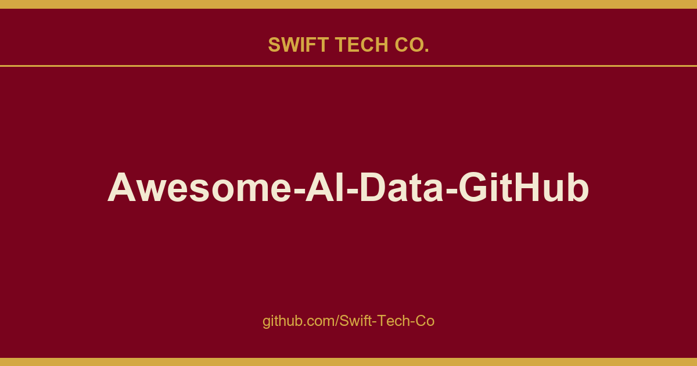

# Awesome-AI-Data-GitHub-Repos

## What This Is

Every project needs a shelf of ready answers. product and engineering is one of those shelves, and Awesome-AI-Data-GitHub-Repos is the entry on it - the notes, patterns and fixes we reuse when this kind of work comes up.

## Images

## Table of Contents:
* [Natural Language Processing (NLP)](https://github.com/Swift-Tech-Co/Awesome-AI-Data-GitHub-Repos)
* [Large Language Models(LLM)](https://github.com/Swift-Tech-Co/Awesome-AI-Data-GitHub-Repos)
* [Computer Vision](https://github.com/Swift-Tech-Co/Awesome-AI-Data-GitHub-Repos)
* [Data Science](https://github.com/Swift-Tech-Co/Awesome-AI-Data-GitHub-Repos)
* [Machine Learning](https://github.com/Swift-Tech-Co/Awesome-AI-Data-GitHub-Repos)
* [Machine Learning Projects](https://github.com/Swift-Tech-Co/Awesome-AI-Data-GitHub-Repos)
* [Machine Learning Engineerings Operations (MLOps)](https://github.com/Swift-Tech-Co/Awesome-AI-Data-GitHub-Repos),-MLOps%2DBasics)
* [Data Engineering](https://github.com/Swift-Tech-Co/Awesome-AI-Data-GitHub-Repos)
* [SQL & Database](https://github.com/Swift-Tech-Co/Awesome-AI-Data-GitHub-Repos)
* [Statistics](https://github.com/Swift-Tech-Co/Awesome-AI-Data-GitHub-Repos)

## Natural Language Processing ##

* [nlp-tutorial](https://github.com/Swift-Tech-Co/Awesome-AI-Data-GitHub-Repos): nlp-tutorial is a tutorial for who is studying NLP(Natural Language Processing) using Pytorch. Most NLP models were implemented with less than 100 lines of code.

## Large Language Models ##

* [LLMs Practical Guide: The Practical Guides for Large Language Models](https://github.com/Swift-Tech-Co/Awesome-AI-Data-GitHub-Repos)
* [LLM Survey: A collection of papers and resources related to Large Language Models](https://github.com/Swift-Tech-Co/Awesome-AI-Data-GitHub-Repos)
* [Open LLMs: List of LLMs that are all licensed for commercial](https://github.com/Swift-Tech-Co/Awesome-AI-Data-GitHub-Repos)
* [Awesome LLM: Curated list of papers about large language models, especially relating to ChatGPT](https://github.com/Swift-Tech-Co/Awesome-AI-Data-GitHub-Repos)
* [Awesome Decentralized LLM: Collection of LLM resources that can be used to build products you can "own" or to perform reproducible research](https://github.com/Swift-Tech-Co/Awesome-AI-Data-GitHub-Repos)
* [LangChain: Building applications with LLMs through composability](https://github.com/Swift-Tech-Co/Awesome-AI-Data-GitHub-Repos)
* [Awesome LangChain: Curated list of tools and projects using LangChain](https://github.com/Swift-Tech-Co/Awesome-AI-Data-GitHub-Repos)
* [Awesome-Graph-LLM: A collection of AWESOME things about Graph-Related Large Language Models (LLMs).](https://github.com/Swift-Tech-Co/Awesome-AI-Data-GitHub-Repos)
* [DemoGPT: Auto Gen-AI App Generator with the Power of Llama 2](https://github.com/Swift-Tech-Co/Awesome-AI-Data-GitHub-Repos)
* [OpenLLM: An open platform for operating large language models (LLMs) in production](https://github.com/Swift-Tech-Co/Awesome-AI-Data-GitHub-Repos)
* [LLM Zoo: democratizing ChatGPT](https://github.com/Swift-Tech-Co/Awesome-AI-Data-GitHub-Repos)
* [VectorDB-recipes](https://github.com/Swift-Tech-Co/Awesome-AI-Data-GitHub-Repos)
* [Awesome GPT Prompt Engineering: A curated list of awesome resources, tools, and other shiny things for GPT prompt engineering](https://github.com/Swift-Tech-Co/Awesome-AI-Data-GitHub-Repos)
* [Prompt Engineering Guide: ](https://github.com/Swift-Tech-Co/Awesome-AI-Data-GitHub-Repos)
* [LLM Course](https://github.com/Swift-Tech-Co/Awesome-AI-Data-GitHub-Repos)

## Computer Vision ## 

* [Awesome Computer Vision: A curated list of awesome computer vision resources](https://github.com/Swift-Tech-Co/Awesome-AI-Data-GitHub-Repos)
* [Computer Vision Tutorials by Roboflow](https://github.com/Swift-Tech-Co/Awesome-AI-Data-GitHub-Repos)
* [Transformer in Vision: paper list of some recent Transformer-based CV works](https://github.com/Swift-Tech-Co/Awesome-AI-Data-GitHub-Repos)
* [Awesome-Referring-Image-Segmentation: A collection of referring image segmentation papers and datasets](https://github.com/Swift-Tech-Co/Awesome-AI-Data-GitHub-Repos)
* [awesome-vision-language-pretraining-papers: Recent Advances in Vision and Language PreTrained Models (VL-PTMs)](https://github.com/Swift-Tech-Co/Awesome-AI-Data-GitHub-Repos)
* [Awesome Vision-and-Language: A curated list of awesome vision and language resources,](https://github.com/Swift-Tech-Co/Awesome-AI-Data-GitHub-Repos)
* [Awesome-Temporal-Action-Detection-Temporal-Action-Proposal-Generation](https://github.com/Swift-Tech-Co/Awesome-AI-Data-GitHub-Repos)
* [Awesome-Referring-Image-Segmentation: A collection of referring image segmentation papers and datasets.](https://github.com/Swift-Tech-Co/Awesome-AI-Data-GitHub-Repos)
* [Awesome Masked Autoencoders: A collection of literature after or concurrent with Masked Autoencoder (MAE) ](https://github.com/Swift-Tech-Co/Awesome-AI-Data-GitHub-Repos)
* [Awesome Visual-Transformer: Collection of some Transformer with Computer-Vision (CV) papers](https://github.com/Swift-Tech-Co/Awesome-AI-Data-GitHub-Repos)
* [Transformer-Based Visual Segmentation: A Survey](https://github.com/Swift-Tech-Co/Awesome-AI-Data-GitHub-Repos)
* [Awesome-Segmentation-With-Transformer](https://github.com/Swift-Tech-Co/Awesome-AI-Data-GitHub-Repos)
* [CVPR 2o23 Paper with Code](https://github.com/Swift-Tech-Co/Awesome-AI-Data-GitHub-Repos)
* [Awesome Deepfakes Detection](https://github.com/Swift-Tech-Co/Awesome-AI-Data-GitHub-Repos)
* [Weekly-Top-Computer-Vision-Papers](https://github.com/Swift-Tech-Co/Awesome-AI-Data-GitHub-Repos)

## Data Science ##

* [Data Science for Beginners - A Curriculum](https://github.com/Swift-Tech-Co/Awesome-AI-Data-GitHub-Repos)
* [Data Science Resources](https://github.com/Swift-Tech-Co/Awesome-AI-Data-GitHub-Repos)
* [freeCodeCamp.org's open-source codebase and curriculum](https://github.com/Swift-Tech-Co/Awesome-AI-Data-GitHub-Repos)
* [List of Data Science/Big Data Resources](https://github.com/Swift-Tech-Co/Awesome-AI-Data-GitHub-Repos)
* [Open Source Society University: Path to a free self-taught Education in Data Science](https://github.com/Swift-Tech-Co/Awesome-AI-Data-GitHub-Repos)
* [AWESOME DATA SCIENCE: An open-source Data Science repository to learn and apply towards solving real-world problems.](https://github.com/Swift-Tech-Co/Awesome-AI-Data-GitHub-Repos)
* [Data Science ALL CHEAT SHEET](https://github.com/Swift-Tech-Co/Awesome-AI-Data-GitHub-Repos)
* [Data Science End-to-End Projects](https://github.com/Swift-Tech-Co/Awesome-AI-Data-GitHub-Repos)
* [Data Analysis Projects](https://github.com/Swift-Tech-Co/Awesome-AI-Data-GitHub-Repos)
* [Data Science Interview Resources](https://github.com/Swift-Tech-Co/Awesome-AI-Data-GitHub-Repos)
* [Data-Science Interview Questions Answers](https://github.com/Swift-Tech-Co/Awesome-AI-Data-GitHub-Repos)
* [Data-science-best-resources](https://github.com/Swift-Tech-Co/Awesome-AI-Data-GitHub-Repos)
* [Amazing-Feature-Engineering](https://github.com/Swift-Tech-Co/Awesome-AI-Data-GitHub-Repos)
* [Complete-Life-Cycle-of-a-Data-Science-Project](https://github.com/Swift-Tech-Co/Awesome-AI-Data-GitHub-Repos)
* [Data Science Cheatsheet](https://github.com/Swift-Tech-Co/Awesome-AI-Data-GitHub-Repos)
* [PandasAI](https://github.com/Swift-Tech-Co/Awesome-AI-Data-GitHub-Repos)

## Machine Learning ##

* [GitHub Community Discussions](https://github.com/Swift-Tech-Co/Awesome-AI-Data-GitHub-Repos): In this repository, you will find categories for various product areas. Feel free to share feedback, discuss topics with other community members, or ask questions.
* [Awesome Machine Learning](https://github.com/Swift-Tech-Co/Awesome-AI-Data-GitHub-Repos): A curated list of awesome machine learning frameworks, libraries and software (by language).
* [Machine Learning & Deep Learning Tutorials](https://github.com/Swift-Tech-Co/Awesome-AI-Data-GitHub-Repos): This repository contains a topic-wise curated list of Machine Learning and Deep Learning tutorials, articles and other resources
* [Best-of Machine Learning with Python](https://github.com/Swift-Tech-Co/Awesome-AI-Data-GitHub-Repos): A ranked list of awesome machine learning Python libraries.
* [TensorFlow Examples](https://github.com/Swift-Tech-Co/Awesome-AI-Data-GitHub-Repos): This tutorial was designed for easily diving into TensorFlow, through examples. For readability, it includes both notebooks and source codes with explanations, for both TF v1 & v2.
* [Machine Learning Projects](https://github.com/Swift-Tech-Co/Awesome-AI-Data-GitHub-Repos)
* [Randy Olson's data analysis and machine learning projects](https://github.com/Swift-Tech-Co/Awesome-AI-Data-GitHub-Repos)
* [Minimum Viable Study Plan for Machine Learning Interviews](https://github.com/Swift-Tech-Co/Awesome-AI-Data-GitHub-Repos)
* [Machine Learning Interview Questions: Machine Learning and Computer Vision Engineer](https://github.com/Swift-Tech-Co/Awesome-AI-Data-GitHub-Repos)
* [Must Read Machine Learning & Deep Learning Papers](https://github.com/Swift-Tech-Co/Awesome-AI-Data-GitHub-Repos)
* [Free Machine Learning Books](https://github.com/Swift-Tech-Co/Awesome-AI-Data-GitHub-Repos)

## Machine Learning Projects ## 
* [Orca calls Classifier Project](https://github.com/Swift-Tech-Co/Awesome-AI-Data-GitHub-Repos)
* [Multi-Modal House Price Estimation](https://github.com/Swift-Tech-Co/Awesome-AI-Data-GitHub-Repos)
* [Movie Recommendation System Project](https://github.com/Swift-Tech-Co/Awesome-AI-Data-GitHub-Repos)
* [Land Cover Semantic Segmentation Project](https://github.com/Swift-Tech-Co/Awesome-AI-Data-GitHub-Repos)
* [Music Recommender System using ALS Algorithm with Apache Spark and Python](https://github.com/Swift-Tech-Co/Awesome-AI-Data-GitHub-Repos)
* [Adversarial Task](https://github.com/Swift-Tech-Co/Awesome-AI-Data-GitHub-Repos)
* [Flowers Classification](https://github.com/Swift-Tech-Co/Awesome-AI-Data-GitHub-Repos)
* [99 Machine Learning Projects](https://github.com/Swift-Tech-Co/Awesome-AI-Data-GitHub-Repos)
* [Advanced Machine Learning Projects I](https://github.com/Swift-Tech-Co/Awesome-AI-Data-GitHub-Repos)
* [Advanced Machine Learning II](https://github.com/Swift-Tech-Co/Awesome-AI-Data-GitHub-Repos)

## Machine Learning Engineering Operations (MLOps) ##

* [MLOps Zoomcamp](https://github.com/Swift-Tech-Co/Awesome-AI-Data-GitHub-Repos)
* [MLOps-Basics](https://github.com/Swift-Tech-Co/Awesome-AI-Data-GitHub-Repos)
* [MLOps Guide](https://github.com/Swift-Tech-Co/Awesome-AI-Data-GitHub-Repos)
* [Awesome MLOps](https://github.com/Swift-Tech-Co/Awesome-AI-Data-GitHub-Repos)
* [Awesome MLOps - Tools](https://github.com/Swift-Tech-Co/Awesome-AI-Data-GitHub-Repos)
* [DTU MLOps](https://github.com/Swift-Tech-Co/Awesome-AI-Data-GitHub-Repos)
* [MLOps Course](https://github.com/Swift-Tech-Co/Awesome-AI-Data-GitHub-Repos)

## Data Engineering ##

* [Data Engineering Zoomcamp](https://github.com/Swift-Tech-Co/Awesome-AI-Data-GitHub-Repos)
* [Data Engineering Cookbook](https://github.com/Swift-Tech-Co/Awesome-AI-Data-GitHub-Repos)
* [How To Become a Data Engineer](https://github.com/Swift-Tech-Co/Awesome-AI-Data-GitHub-Repos)
* [Awesome Data Engineering](https://github.com/Swift-Tech-Co/Awesome-AI-Data-GitHub-Repos)
* [Data Engineering Roadmap](https://github.com/Swift-Tech-Co/Awesome-AI-Data-GitHub-Repos)
* [Data Engineering Projects](https://github.com/Swift-Tech-Co/Awesome-AI-Data-GitHub-Repos)
* [Data Engineering Interview Questions](https://github.com/Swift-Tech-Co/Awesome-AI-Data-GitHub-Repos)

## SQL & Database ##

* [SQL 101 by s-shemmee](https://github.com/Swift-Tech-Co/Awesome-AI-Data-GitHub-Repos)
* [Learn SQL by WebDevSimplified](https://github.com/Swift-Tech-Co/Awesome-AI-Data-GitHub-Repos)
* [SQL Masterclass by datawithdanny](https://github.com/Swift-Tech-Co/Awesome-AI-Data-GitHub-Repos)
* [SQL Map by sqlmapproject](https://github.com/Swift-Tech-Co/Awesome-AI-Data-GitHub-Repos)
* [SQL Server Samples by Microsoft](https://github.com/Swift-Tech-Co/Awesome-AI-Data-GitHub-Repos)
* [SQL Music Store Analysis Project by Rishabhnmishra]()
* [Data Engineering Zoomcamp by DataTalksClub]()
* [SQL Server Kit by ktaranov]()
* [Awesome DB Tools by mgramin]()
* [SQL for Wary Data Scientists by gvwilson]()

## Statistics ##
* [Practical Statistics for Data Scientists](https://github.com/Swift-Tech-Co/Awesome-AI-Data-GitHub-Repos)
* [Probabilistic Programming and Bayesian Methods for Hackers](https://github.com/Swift-Tech-Co/Awesome-AI-Data-GitHub-Repos)
* [Statsmodels: Statistical Modeling and Econometrics in Python](https://github.com/Swift-Tech-Co/Awesome-AI-Data-GitHub-Repos)
* [TensorFlow Probability](https://github.com/Swift-Tech-Co/Awesome-AI-Data-GitHub-Repos)
* [The Probability and Statistics Cookbook](https://github.com/Swift-Tech-Co/Awesome-AI-Data-GitHub-Repos)
* [Seeing Theory](https://github.com/Swift-Tech-Co/Awesome-AI-Data-GitHub-Repos)
* [Stats Maths with Python](https://github.com/Swift-Tech-Co/Awesome-AI-Data-GitHub-Repos)
* [Python for Probability, Statistics, and Machine Learning](https://github.com/Swift-Tech-Co/Awesome-AI-Data-GitHub-Repos)
* [Probability and Statistics VIP Cheatsheets](https://github.com/Swift-Tech-Co/Awesome-AI-Data-GitHub-Repos)
* [Basic Mathematics for Machine Learning](https://github.com/Swift-Tech-Co/Awesome-AI-Data-GitHub-Repos)

---

## Swift Tech Co.

Built and maintained by Swift Tech Co.

AI Automation | FinTech Platforms | Custom Software and Mobile Apps | SaaS Platforms | Cloud Infrastructure | Cybersecurity | SEO and Marketing | API Integration

**Join our community on Telegram:** [t.me/+Qt_eFvkb2rliMzNh](https://t.me/+Qt_eFvkb2rliMzNh)

[Home](https://github.com/Swift-Tech-Co/Awesome-AI-Data-GitHub-Repos) | [Services](https://github.com/Swift-Tech-Co/Awesome-AI-Data-GitHub-Repos/services) | [Careers](https://github.com/Swift-Tech-Co/Awesome-AI-Data-GitHub-Repos/careers) | [Referral Program](https://github.com/Swift-Tech-Co/Awesome-AI-Data-GitHub-Repos/referral) | [Influencers](https://github.com/Swift-Tech-Co/Awesome-AI-Data-GitHub-Repos/influencers) | [About](https://github.com/Swift-Tech-Co/Awesome-AI-Data-GitHub-Repos/about) | [Contact](https://github.com/Swift-Tech-Co/Awesome-AI-Data-GitHub-Repos/contact)

**Connect**

- Website: [https://github.com/Swift-Tech-Co/Awesome-AI-Data-GitHub-Repos](https://github.com/Swift-Tech-Co/Awesome-AI-Data-GitHub-Repos)
- LinkedIn: [linkedin.com/in/stephenoladoke](https://www.linkedin.com/in/stephenoladoke/)
- LinkedIn (Company): [linkedin.com/company/swift-tech-co](https://www.linkedin.com/company/swift-tech-co)
- X: [@MrOladoke](https://x.com/MrOladoke)
- Instagram: [@mr.oladoke](https://www.instagram.com/mr.oladoke/)
- Organization: [github.com/Swift-Tech-Co](https://github.com/Swift-Tech-Co)

## Sources

Compiled and maintained from upstream [youssefHosni/Awesome-AI-Data-GitHub-Repos](https://github.com/youssefHosni/Awesome-AI-Data-GitHub-Repos) under permissive open-source license.

---

Maintained by [Swift Tech Co.](https://github.com/Swift-Tech-Co) - [Telegram](https://t.me/+Qt_eFvkb2rliMzNh)